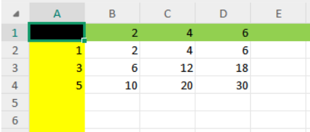

- # **题目链接：**

[智乃的“凑数”题（Easy Version）_牛客题霸_牛客网](https://www.nowcoder.com/practice/35484cd18f364ca3b9bbda2a136dc4fb?channelPut=tracker2)

- # **题目描述：**

一天，智乃打开了她的电子表格，开始研究这样一个 “凑数” 问题。



现在有 n 个整数 \(k_1,k_2,\dots,k_n\)，对于每个数字，智乃会从以下三种操作中选择一种执行：

- 将这个数字添加到电子表格的行头中，记作 \(a_i\)；
- 将这个数字添加到电子表格的列头中，记作 \(b_j\)；
- 放弃这个数字。

在全部 n 个整数均执行完成操作后，对于整个二维表格的权值，记作 \(\displaystyle val=\sum_{i=1}^{r}\sum_{j=1}^{c} a_i \times b_j\)。例如，在上图例中行头为 \(a=\{2,4,6\}\)，列头为 \(b=\{1,3,5\}\)，则 \(val = 2+4+6+6+12+18+10+20+30 = 108\)。

特别的，如果在进行若干次操作后行或者列仍然为空，则规定此时 \(val=0\)。

智乃现在想知道，对于一开始的这 n 个数，是否存在一种操作方案，使得表格权值恰好为 x？如果存在，输出任意一种满足条件的操作方案，详细的输出格式见输出描述；否则告诉她不可能。 你需要处理 m 次询问，每次询问彼此独立，即都是从一开始的状态重新选择操作。

## 输入描述

第一行输入两个正整数 \(n,m\ (1 \le n \le 100;\ 1 \le m \le 100)\) 代表数字的个数、查询的数目。 第二行输入 n 个正整数 \(k_1,k_2,\dots,k_n\ (1 \le k_i \le 100)\) 代表数字。 此后 m 行，第 i 行输入一个正整数 \(x_i\ (1 \le x_i \le 100)\) 代表第 i 次询问的表格权值。

## 输出描述

对于每一次询问，如果不存在满足条件的操作方案，直接输出 `No`。

否则，请参考下方的格式输出。 第一行输出 `Yes`。 第二行输出两个正整数 \(l_a,l_b\ (1 \le l_a,l_b \le n;\ l_a+l_b \le n)\) 代表行头的长度、列头的长度。 第三行输出 \(l_a\) 个正整数 \(a_1,a_2,\dots,a_{l_a}\) 代表行头的内容，您可以以任意顺序输出。 第四行输出 \(l_b\) 个正整数 \(b_1,b_2,\dots,b_{l_b}\) 代表列头的内容，您也可以以任意顺序输出。

如果存在多个解决方案，您可以输出任意一个，系统会自动判定是否正确。注意，自测运行功能可能因此返回错误结果，请自行检查答案正确性。

- # **题目题解：**

\(\displaystyle val=\sum_{i}\sum_j a_i b_j = (\sum a_i)\times(\sum b_j)\)

 ```cpp
 #include<bits/stdc++.h>
 using namespace std;
 using ll=long long;
 using ull=unsigned long long;
 using ill=__int128;
 const ll mod1=1e9+7;
 const ll mod2=998244353;
 bool is[110][110];
 pair<ll,ll>pr[110][110];
 int main(){
     ios::sync_with_stdio(false);
     cin.tie(0);cout.tie(0);
     ll n,m;cin>>n>>m;
     vector<ll>k(n+1,0);
     for(ll i=1;i<=n;i++)cin>>k[i];
     is[0][0]=true;
     for(ll i=1;i<=n;i++){
         for(ll j=100;j>=0;j--){
             for(ll p=100;p>=0;p--){
                 if(is[j][p]){
                     if((j+k[i])<=100&&!is[j+k[i]][p]){
                         is[j+k[i]][p]=true;
                         pr[j+k[i]][p]={j,p};
                     }
                     if((p+k[i])<=100&&!is[j][p+k[i]]){
                         is[j][p+k[i]]=true;
                         pr[j][p+k[i]]={j,p};
                     }
                 }
             }
         }
     }
     while(m--){
         ll x;cin>>x;
         ll i=0;
         for(i=1;i*i<=x;i++){
             if(x%i==0){
                 if(is[i][x/i])break;
             }
         }
         if((i*i)>x){
             cout<<"No"<<'\n';continue;
         }
         ll j=x/i;
         vector<ll>a;
         vector<ll>b;
         while(i>0||j>0){
             if(pr[i][j].first==i){
                 b.push_back(j-pr[i][j].second);
                 j=pr[i][j].second;
             }else{
                 a.push_back(i-pr[i][j].first);
                 i=pr[i][j].first;
             }
         }
         cout<<"Yes"<<'\n';
         cout<<a.size()<<' '<<b.size()<<'\n';
         for(auto z:a)cout<<z<<' ';
         cout<<'\n';
         for(auto z:b)cout<<z<<' ';
         cout<<'\n';
     }
     return 0;
 }
 ```

